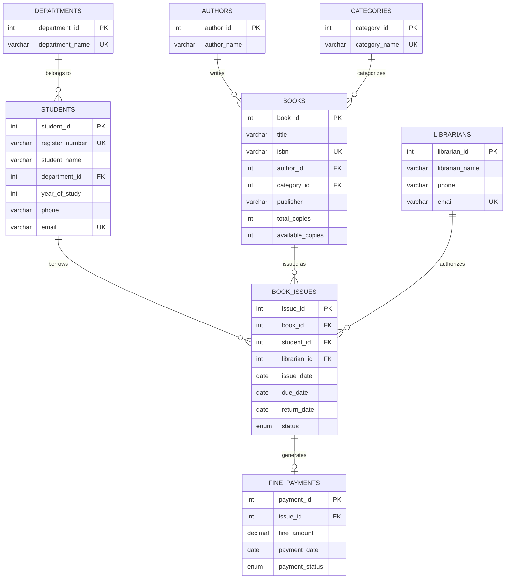

# Automated Library Book Tracking and Management System

**College Project:** 2nd Year B.Tech — Artificial Intelligence and Data Science (AI & DS)  
**Course:** Database Management Systems (DBMS) & Full-Stack Web Development  
**Database:** MySQL 8.0 / MySQL Workbench (`library_management_db`)  
**Backend:** Python 3.13 / Flask  
**Frontend:** HTML5, CSS3, JavaScript (ES6), Bootstrap 5, Bootstrap Icons, Chart.js  

---

## 1. Project Overview

The **Automated Library Book Tracking and Management System** is a full-stack academic web application designed to automate and streamline core library operations in an engineering college. It eliminates manual record-keeping by providing automated inventory tracking, real-time stock availability, overdue fine calculations, interactive data analytics, and ACID-compliant transaction processing for book circulation.

### Key Highlights:
- **Zero Inventory Drift:** Book stock quantities (`available_copies` vs. `total_copies`) are maintained using MySQL Triggers and atomic transactions.
- **Automated Fine Computation:** Calculates daily overdue penalties (₹5.00/day) based on dynamic date differentials.
- **SQL Analytics Dashboard:** Interactive doughnut and bar charts visualizing book distributions and borrowing trends by department.
- **100% Parameterized Queries:** Full protection against SQL Injection vulnerabilities.

---

## 2. Project Directory Structure

```text
library-management-system/
│
├── app.py                      # Flask Application Controller & Route Handlers
├── db.py                       # MySQL Database Connectivity & Transaction Layer
├── requirements.txt            # Python Dependencies
├── schema.sql                  # Complete MySQL DDL, Views, Procedures & Seed Data
├── README.md                   # Project Documentation & Viva Guide
│
├── templates/                  # Jinja2 HTML Templates
│   ├── base.html               # Master Layout (Sidebar, Topbar, Flash Alerts)
│   ├── index.html              # Dashboard with Metrics & Chart.js Visuals
│   ├── books.html              # Book Catalog with Search & Availability Badges
│   ├── add_book.html           # Add New Book Form (with dynamic Author/Category)
│   ├── edit_book.html          # Update Book Details & Inventory Copies
│   ├── students.html           # Student Records Directory
│   ├── add_student.html        # Register New Student Member
│   ├── edit_student.html       # Edit Student Profile
│   ├── student_history.html    # Student Lifetime Borrowing History
│   ├── issue_book.html         # Book Issuance Form (Auto-Due Date + Stock Check)
│   ├── issued_books.html       # Circulation Desk (Active, Overdue, Returns)
│   └── reports.html            # Reports, Fine Audits, and DBMS Concept Showcase
│
└── static/                     # Static Frontend Assets
    ├── style.css               # Custom Styling (Blue-and-White Theme)
    └── script.js               # Modal Handlers, Live Filters & Chart.js Config
```

---

## 3. Database Architecture & ER Diagram

The database `library_management_db` contains **8 normalized relational tables** demonstrating primary keys, foreign keys, cascade actions, and table constraints:



---

## 4. Normalization Walkthrough (1NF to 3NF)

The database schema was rigorously normalized from a hypothetical unnormalized flat spreadsheet:

1. **First Normal Form (1NF):**
   - Each column contains only **atomic (indivisible) values** (e.g., student name and contact details are separated).
   - Eliminated repeating groups (no multiple book IDs or authors stored in comma-separated strings).
   - Defined unique primary keys for every entity (`book_id`, `student_id`, `issue_id`).

2. **Second Normal Form (2NF):**
   - Satisfies 1NF.
   - All non-key attributes are **fully functionally dependent** on the primary key.
   - Separate tables exist for `students`, `books`, and `book_issues` rather than mixing student names inside issue records.

3. **Third Normal Form (3NF):**
   - Satisfies 2NF.
   - **No transitive dependencies** ($X \rightarrow Y$ and $Y \rightarrow Z$):
     - Author names are moved to `authors(author_id, author_name)`.
     - Department names are moved to `departments(department_id, department_name)`.
     - Category genres are moved to `categories(category_id, category_name)`.
     - This prevents update, deletion, and insertion anomalies (e.g., deleting a book will not delete author information).

---

## 5. DBMS Concepts Demonstrated

### A. SQL Constraints
- **Primary Key (PK):** `AUTO_INCREMENT` unique identifiers for every table.
- **Foreign Key (FK):** `CONSTRAINT fk_issues_book FOREIGN KEY (book_id) REFERENCES books(book_id) ON DELETE RESTRICT`.
- **CHECK Constraints:**
  - `CHECK (total_copies >= 0)`
  - `CHECK (available_copies >= 0)`
  - `CHECK (available_copies <= total_copies)`
  - `CHECK (year_of_study BETWEEN 1 AND 4)`
  - `CHECK (fine_amount >= 0.00)`
- **UNIQUE Constraints:** `isbn` on books, `register_number` and `email` on students, `department_name` on departments.
- **NOT NULL & DEFAULT:** `total_copies DEFAULT 1`, `payment_status DEFAULT 'Pending'`.

### B. SQL Joins & Aggregate Queries
- **INNER JOIN:** Used when joining `book_issues` with `books` and `students` where active matching records exist.
- **LEFT JOIN:** Used when displaying books that may not currently have an author or category assigned, and when computing department statistics even if a department has 0 registered students.
- **Aggregate Functions & GROUP BY:**
  ```sql
  SELECT 
      d.department_name,
      COUNT(DISTINCT s.student_id) AS total_students,
      COUNT(bi.issue_id) AS total_issues_count
  FROM departments d
  LEFT JOIN students s ON d.department_id = s.department_id
  LEFT JOIN book_issues bi ON s.student_id = bi.student_id
  GROUP BY d.department_id, d.department_name
  HAVING total_students >= 0;
  ```

### C. MySQL Views
1. `view_book_details`: Joins `books`, `authors`, and `categories` to provide a consolidated catalog with live stock counts.
2. `view_issued_books_details`: Joins `book_issues`, `books`, `students`, `departments`, `librarians`, and `fine_payments`.
3. `view_overdue_books`: Filters `view_issued_books_details` for records where `status = 'Issued' AND due_date < CURDATE()`.
4. `view_department_issue_stats`: Aggregates circulation frequency grouped by academic branch.

### D. Triggers
- `trg_prevent_negative_copies`: A `BEFORE INSERT` trigger on `book_issues` that raises SQL error state `'45000'` if `available_copies <= 0`.
- `trg_decrement_copies_after_issue`: An `AFTER INSERT` trigger on `book_issues` that automatically decreases `available_copies` on `books`.
- `trg_increment_copies_after_return`: An `AFTER UPDATE` trigger on `book_issues` that increments `available_copies` when status changes from `'Issued'` to `'Returned'`.

### E. Stored Procedures
- `sp_issue_book(p_book_id, p_student_id, p_librarian_id, p_due_date)`: Encapsulates stock checks and record creation inside MySQL.
- `sp_return_book(p_issue_id, p_fine_rate)`: Updates return timestamp and records late penalty fees.

### F. ACID Transactions
In `db.py` and `app.py`, multi-step updates are wrapped in `execute_transaction`:
- **Atomicity:** `INSERT INTO book_issues` and `UPDATE books` execute together. If either query fails, `conn.rollback()` executes, preventing orphan or inconsistent records.
- **Consistency:** Database invariants (`available_copies >= 0`) are never violated.
- **Isolation:** Operations run in isolated database cursor states.
- **Durability:** Changes are permanently saved on `conn.commit()`.

---

## 6. Setup and Execution Instructions (Windows PowerShell)

### Step 1: Verify Prerequisites
Make sure Python and MySQL Server are installed and running on your system.

```powershell
# Check Python version (Python 3.10+ recommended)
python --version

# Verify MySQL Service is running
Get-Service -Name MySQL80
```

### Step 2: Navigate to Project Directory
```powershell
cd c:\Users\thenn\Desktop\library-management-system
```

### Step 3: Install Required Python Packages
```powershell
pip install -r requirements.txt
```

### Step 4: Import Database Schema (Optional if already configured)
If setting up on a new machine or re-importing the database:
```powershell
# You can open schema.sql in MySQL Workbench and execute the script,
# or execute directly through Python:
python -c "import db; print('Connection test:', db.test_connection())"
```

### Step 5: Start the Flask Application
```powershell
python app.py
```

### Step 6: Access the Application
Open your web browser and navigate to:
```text
http://127.0.0.1:5000
```

---

## 7. College Review & Viva Preparation Guide

Here are standard questions professors ask during college project reviews, along with recommended answers:

### Q1: What is the primary purpose of normalizing your database to 3NF?
> **Answer:** Normalization eliminates data redundancy and prevents insertion, update, and deletion anomalies. For instance, rather than typing the author's name repeatedly for every book copy, we separate authors into an `authors` table with an `author_id` foreign key. If an author's name needs updating, we update it once without affecting inventory records.

### Q2: How does the system handle concurrent book requests when only 1 copy is left?
> **Answer:** We enforce consistency through two levels of defense:
> 1. A MySQL `CHECK (available_copies >= 0)` constraint and a `BEFORE INSERT` trigger (`trg_prevent_negative_copies`) that rejects any transaction attempting to issue an out-of-stock book.
> 2. Database transactions using `START TRANSACTION`, row updates, and `COMMIT / ROLLBACK` to maintain ACID compliance.

### Q3: What is the difference between an INNER JOIN and a LEFT JOIN in your project?
> **Answer:** 
> - An **INNER JOIN** is used when both sides of the relationship must exist. For example, in circulation reports, we inner join `book_issues` with `books` and `students` because every issued record strictly requires a valid book and student.
> - A **LEFT JOIN** is used when parent records must appear even if child records do not exist. For example, in `view_department_issue_stats`, we left join `departments` with `students` and `book_issues` so that departments with 0 loans still appear in the report table with a count of 0.

### Q4: How is the overdue fine calculated?
> **Answer:** The system dynamically computes the overdue duration using:
> `GREATEST(0, DATEDIFF(CURDATE(), due_date))`
> If the current date is past the due date and the status is `'Issued'`, each overdue day is multiplied by the college fine rate of ₹5.00. When the book is returned, a fine payment record is generated in `fine_payments`.

### Q5: How do you prevent SQL Injection attacks?
> **Answer:** We never concatenate raw user inputs into SQL strings. All queries in `db.py` and `app.py` utilize parameterized queries with placeholders (`%s`), delegating parameter sanitization and escaping directly to the MySQL database driver.
